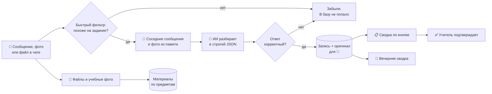
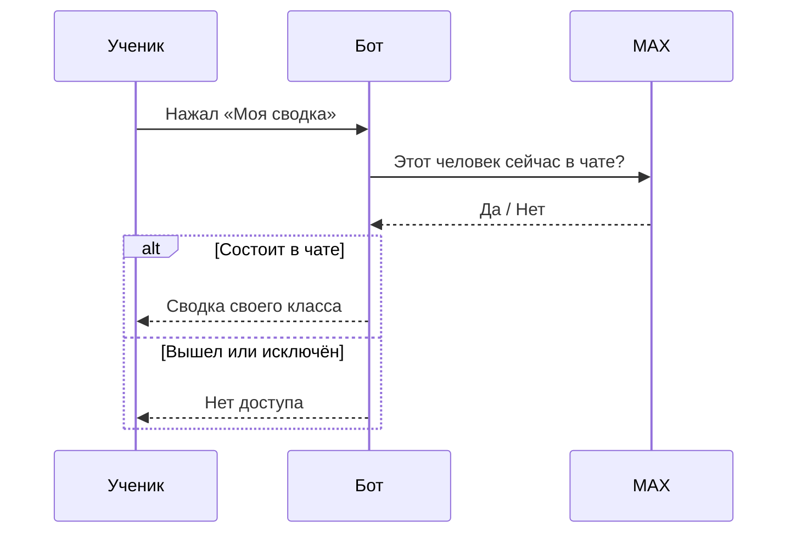
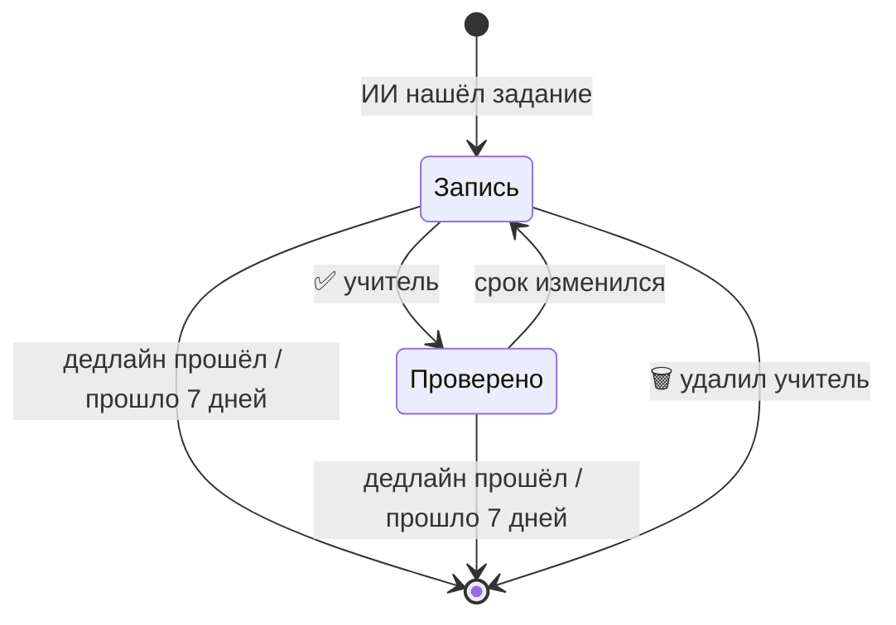
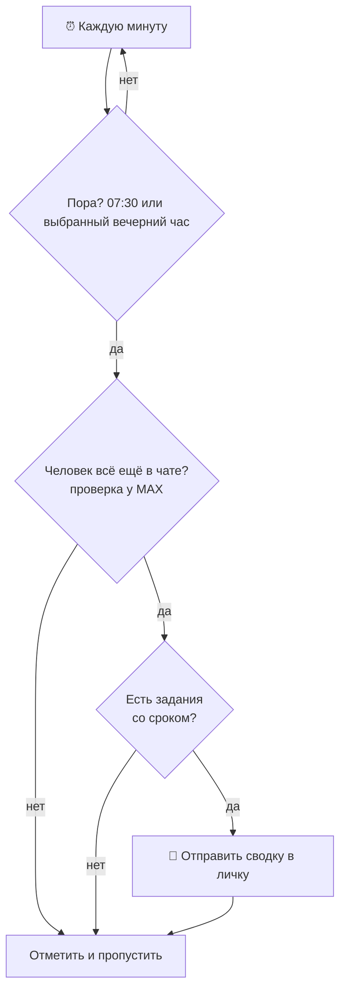

<div align="center">


# Сферум.Сводка

### Чат класса, в котором больше не теряется домашка

Бот для **MAX** читает чаты класса и собирает главное: **что проходили, что задали и к какому сроку**.
К каждой строке прилагается **источник**, фото с домашкой читаются, задания из нескольких сообщений склеиваются,
материалы раскладываются по предметам, а вечером приходит **напоминание о дедлайнах**.

[](https://max.ru/ideya_fiks_87_bot)
&nbsp;


**Хакатон «Идея фикс»** · направление «Портал в будущее» · номинация «Продвинутая разработка»

[Идея](#-идея) ·
[Возможности](#-возможности) ·
[Как выглядит](#-как-это-выглядит) ·
[Как пользоваться](#-как-пользоваться) ·
[Как работает](#-как-это-работает) ·
[Приватность](#-приватность-и-доступ) ·
[Запуск](#-запуск) ·
[Тесты](#-тесты) ·
[Команда](#-команда)

</div>

---

## 💡 Идея

В чате класса домашка тонет среди сообщений, стикеров и пересланных файлов. Заболел, пропустил урок или не успел прочитать 200 сообщений за вечер — приходится спрашивать одноклассников и надеяться, что ответят правильно.

**Сферум.Сводка** превращает поток сообщений в короткую понятную сводку и сама напоминает о сроках:

| Было | Стало |
|---|---|
| Листать чат и искать «а что задали?» | Нажать одну кнопку |
| «ДЗ на завтра» в одном сообщении, номера в другом, фото в третьем | Бот собирает их в **одну запись** |
| Домашка пришла фотографией доски или учебника | Бот **читает фото** и прикладывает его к записи 📷 |
| Конспекты и файлы теряются выше по чату | Блок **«Материалы»** по предметам |
| Не понятно, кому верить | У каждой строки **источник 🔎** и отметка **✅ «проверено»** |
| Забыл про сдачу | **Вечерняя сводка** и утреннее напоминание |
| Несколько чатов — несколько поисков | Сводки **всех чатов** одним нажатием |
| Данные неизвестно где и сколько хранятся | Хранится только нужное, **не дольше 7 дней** |

---

## ✨ Возможности

### 📋 Сводка класса
- **Что в сводке:** 📚 что проходили · 📝 домашнее задание и дедлайны · отметки проверенного.
- **Умные сроки:** «до пятницы», «на завтра», «к 15 ноября» превращаются в конкретную дату.
- **Самоочистка:** прошёл дедлайн или записи больше 7 дней — они исчезают сами.
- **Без дублей:** повторное напоминание обновляет запись, а не создаёт вторую. Исправили сообщение — запись обновилась.

### 🧠 Понимает живой язык
Ученики пишут не по шаблону, и бот к этому готов. Перед ИИ стоит быстрый фильтр из 8 групп слов, который узнаёт задание по любому признаку:

| Группа | Примеры |
|---|---|
| Сильные слова | «ДЗ», «д/з», «домашка», «задали», «задание», «на дом» |
| Действия | выучить, решить, написать, принести, подготовить, нарисовать, сдать |
| Место в учебнике | параграф, §, стр. 45, №112, упр. 245, учебник, тетрадь |
| Виды работ | доклад, реферат, проект, сочинение, диктант, презентация |
| Контрольные | к/р, с/р, тест, ВПР, ОГЭ, ЕГЭ, зачёт, проверочная |
| Что проходили | «на уроке прошли», «разобрали», «изучали» |
| Сроки | «до завтра», «к понедельнику», «до 15.11», «к следующему уроку» |
| Предметы | 40+ названий и сокращений: алгебра, англ. яз., ОБЖ, ИЗО… |

Фраза **«Алгебра до завтра сделать куб из бумаги»** без слова «ДЗ» разбирается так же, как «ДЗ на завтра по алгебре». А «ок», «кто идёт на физру?» и «завтра в кино пойдём?» ИИ не отправляются: токены не тратятся, в базу ничего не попадает.

### 🔎 Источник у каждой строки
Под сводкой стоят кнопки **🔎 1, 🔎 2…**. Нажмите — увидите, кто, когда и что именно написал, а при наличии фото — и само фото. Под источником есть кнопки **«◀ К сводке»** и **«🏠 Меню»**, так что можно быстро открыть следующий источник или вернуться домой.

### 📷 Фото и задания из нескольких сообщений
Задание в чате редко приходит одним сообщением: «ДЗ на завтра», потом «номер 112, стр. 45», потом фото страницы. Бот **помнит ближайшие сообщения чата** (только в оперативной памяти) и разбирает их вместе:
- **Контекст.** «ДЗ на завтра по алгебре» + «номер 112, 45 страница» превращаются в одну запись «Алгебра: №112, стр. 45 — до завтра».
- **Фото.** Фото учебника, доски или дневника читает модель с изображением. Бот понимает, что это ДЗ: по подписи, по соседним сообщениям или по содержимому (режим `PHOTO_SCAN`, см. [настройки](#-настройки)). Перед отправкой фото сжимается, поэтому читается быстро и стоит дёшево.
- **Фото пришло раньше текста.** Оно ждёт, и если следом придёт «ДЗ на завтра», будет прочитано вместе с ним.
- **Приложение к записи.** Строка получает 📷, а по 🔎 бот присылает исходное сообщение и фото. Само фото мы не храним: в записи лежит только ссылка на файл в MAX.
- **Черновики заменяются.** Неполная запись «Без предмета: ДЗ на завтра» заменяется полной, подтверждённые учителем записи не трогаются.

### 📥 История за 7 дней
Бот не начинает с пустого листа. При добавлении в чат он **сам читает сообщения за последние 7 дней** и собирает записи и материалы теми же правилами, что и для новых сообщений. Кнопка **«📥 История за 7 дней»** повторяет чтение. Расход ИИ ограничен потолками, поэтому большой чат не опустошит баланс.

### 📎 Материалы по предметам
Файлы (конспекты, презентации, образцы) и фото с подписью вроде «конспект по физике» **раскладываются по предметам** — без обращения к ИИ, по подписи, названию файла и соседним сообщениям. Фото задания тоже попадает в материалы своего предмета. Кнопка **«📎 Материалы»** показывает список, **«📎 1, 2…»** присылает файл ещё раз. Файлы мы не скачиваем и не храним: только название, предмет, дата и токен-ссылка MAX.

### 🔔 Вечерняя сводка и напоминания
Кнопка **«🔔 Напоминания»** включает:
- **🌙 вечернюю сводку** (18, 19, 20 или 21 час на выбор): что сдавать завтра, что сегодня последний день, ближайшие сроки, сколько новых материалов;
- **☀️ утреннее напоминание в 07:30**: что сдавать сегодня.

Если заданий нет, бот молчит. Сводка собирается из всех ваших классов, и доступ проверяется в MAX: вышедший из чата её больше не получит. Кнопка **«📨 Прислать сейчас»** показывает, как выглядит сводка.

### ✅ Проверка учителем
- Кнопка **«✅ Подтвердить всё»** подтверждает всю сводку одним нажатием.
- В источнике учитель может подтвердить **одну** запись или **🗑 удалить** ошибочную.
- Подтверждённые строки получают ✅, а в подвале сводки появляется «Всё проверено учителем».
- Если после подтверждения срок изменился, отметка ✅ снимается: учитель проверял другое.
- Подтверждать может **владелец чата** или **учитель, введший код** (кнопка «👩‍🏫 Я учитель»).

### 👥 Классы и участники
- Бот **сам находит всех участников** чата, писать в чат не нужно.
- **Название чата** берётся из MAX автоматически, при желании его можно задать кнопкой ✏️.
- В личке: выбрать один чат или получить **сводки всех чатов сразу**.
- Классы **полностью изолированы**: сводку видит только тот, кто состоит в чате.

### 🎬 Демо без своего класса
Кнопка **«Демо»** открывает вымышленный класс 7Б со всеми возможностями: проверенные и непроверенные записи, 📷, источники и пример вечерней сводки. Попробовать бота можно за минуту.

### 🖱 Всё на кнопках
Команды запоминать не нужно: главное меню, меню чата, выбор класса, подтверждение, материалы, настройки напоминаний.

---

## 📱 Как это выглядит

**Сводка класса:**

```
━━ 7Б ━━
📚 Что проходили
1. Физика: Законы Ньютона ✅
2. История: Реформы Петра I

📝 Домашнее задание и дедлайны
3. Алгебра: №215–218 — до вт, 03.11 ✅
4. Литература: выучить стихотворение — до ср, 04.11
5. Биология: параграф 12, вопросы — до пт, 06.11 📷

🔎 — показать исходное сообщение
✅ — проверено учителем, остальное: ИИ · не проверено

[🔎 1] [🔎 2] [🔎 3] [🔎 4]
[🔎 5]
[✅ Подтвердить всё]            ← только для учителя
[🏠 Меню]
```

**Источник записи (кнопка 🔎 4):**

```
🔎 Источник записи
Литература: выучить стихотворение — до ср, 04.11

Учитель литературы, 02.11 в 18:20:
«Не забудьте выучить стихотворение наизусть к четвергу»

[✅ Подтвердить]  [🗑 Удалить]      ← только для учителя
[◀ К сводке]      [🏠 Меню]
```

**Материалы:**

```
📎 Материалы класса

📘 Алгебра
1. 📷 Фото задания · 05.11

📘 Физика
2. 📄 Законы_Ньютона.pdf · 04.11

[📎 1] [📎 2]
[📋 Сводка]
```

**Вечерняя сводка:**

```
🌙 Вечерняя сводка · чт, 05.11

⏰ Сдавать завтра
• Алгебра: №215–218 ✅

📅 Ближайшие дни
• Литература: выучить стихотворение — до вс, 08.11

📝 Ещё заданий без срока: 1
📎 Новых материалов за сутки: 2
```

**Главное меню бота:**

```
Привет! Я Сферум.Сводка 💙

[📋 Моя сводка]
[🗂 Все чаты сразу]
[📎 Материалы] [🔔 Напоминания]
[🎬 Демо]
[👩‍🏫 Я учитель]
[❓ Как подключить класс]
```

---

## 🧭 Как пользоваться

### 🎒 Ученик
1. Откройте бота в MAX и нажмите **«Старт»**.
2. **📋 Моя сводка** — если ваш класс один, сводка покажется сразу, если несколько — выберите.
3. **🗂 Все чаты сразу** — сводки всех ваших классов подряд.
4. **📎 Материалы** — конспекты и файлы по предметам.
5. **🔔 Напоминания** — включите, и бот сам напомнит о сроках.
6. Сомневаетесь в строке — нажмите **🔎** и прочитайте оригинал.

### 👩‍🏫 Учитель или владелец чата
1. Откройте сводку своего класса: внизу появится **«✅ Подтвердить всё»**.
2. Чтобы проверить строку точечно, нажмите её **🔎**, затем **✅ Подтвердить** или **🗑 Удалить**.
3. Учитель, не являющийся владельцем чата, нажимает **«👩‍🏫 Я учитель»** в личке бота и вводит код школы (задаётся в `.env`). После этого он подтверждает записи во всех чатах, где состоит.

### 🔌 Подключение класса

```
1  Добавьте бота в чат класса
2  Сделайте его администратором    (MAX отдаёт сообщения и список участников только администратору)
3  Бот сам найдёт название чата и всех участников и прочитает сообщения за 7 дней
4  Каждый ученик открывает бота и нажимает «📋 Моя сводка»
```

Если список участников не подтянулся, нажмите в чате **«🔄 Обновить участников»**.

---

## 🧩 Как это работает

### Путь сообщения



### Кто что видит



### Жизнь данных



### Напоминания



---

## 🎯 Почему сводке можно верить

ИИ в школьном чате должен быть не «оракулом», а помощником с проверкой. Поэтому у нас несколько уровней защиты:

| Уровень | Что делает |
|---|---|
| 🪣 **Фильтр до ИИ** | «ок», стикеры и болтовня не уходят в модель и не сохраняются |
| 📐 **Строгий формат** | ИИ обязан вернуть JSON; всё, что не подходит по схеме, отбрасывается |
| 🛡 **Сообщение — это данные** | Инструкции внутри сообщения («забудь все правила») игнорируются |
| 🔎 **Источник** | У каждой строки есть оригинал и фото: можно проверить за секунду |
| ✅ **Подтверждение человеком** | Учитель или владелец чата ставит «проверено» |
| 🔁 **Снятие отметки** | Изменился срок — ✅ снимается |
| 🏷 **Честная метка** | Пока не проверено, в подвале написано «ИИ · не проверено учителем» |

---

## 🔒 Приватность и доступ

**Кто видит сводку.** Только тот, кто состоит в чате *прямо сейчас*. Перед каждой сводкой, кнопкой и напоминанием бот спрашивает у MAX, есть ли человек в чате. Вышел или исключён — доступ закрывается сразу. Если MAX временно не отвечает, бот верит своей записи только до 6 часов. Бот слушает события выхода участников и раз в 6 часов сверяет весь список.

**Кто подтверждает.** Только владелец чата или учитель с кодом, и только в чатах, где он состоит.

**Что хранится и сколько:**

| Данные | Хранится | Срок |
|---|---|---|
| Текст сообщения | только если из него получилась запись (нужен для 🔎) | пока жива запись, максимум 7 дней |
| Остальные сообщения («ок», стикеры, болтовня) | **не сохраняются** | сразу забываются |
| Запись (предмет, задание, срок, отметка ✅) | да | до дедлайна; без срока — 7 дней |
| Участники | только числовой id, без имён | пока человек в чате |
| Учителя | только числовой id | пока бот работает |
| Имя автора | только в подписи источника 🔎 | вместе с оригиналом |
| Последние сообщения чата для контекста | только в оперативной памяти | 10 минут, пропадают при перезапуске |
| Фото | читаются в памяти и забываются; в записи только токен-ссылка на файл в MAX | пока жива запись |
| Материалы (название файла, предмет, дата, токен-ссылка MAX) | да, без авторов и без самих файлов | 30 дней |
| История чата за 7 дней | читается один раз, дальше как обычные сообщения: хранятся только записи и их оригиналы | не дольше 7 дней |
| Подписка на напоминания (числовой id и время) | только если человек сам включил | пока не выключит |

Бота убрали из чата — **все данные этого чата удаляются**. Устаревшее чистится автоматически каждые 6 часов.

**Фото и ИИ.** Чтобы прочитать фото, бот отправляет его (уменьшенную копию) в ИИ-сервис из `AI_BASE_URL`. По умолчанию (`PHOTO_SCAN=hinted`) это происходит только если рядом есть подсказка про домашку; режим `off` полностью отключает чтение фото.

**Секреты.** Токен бота, ключ ИИ и код учителя лежат только в `.env`. Файл не попадает ни в репозиторий (`.gitignore`), ни в Docker-образ (`.dockerignore`). Код учителя сравнивается безопасным способом, после 5 неверных попыток включается пауза на 15 минут. В контейнере бот работает не от root.

---

## 🛠 Технологии

| Слой | Что используем |
|---|---|
| Бот | Python 3.12, [`maxapi`](https://pypi.org/project/maxapi/), long polling |
| ИИ | любой OpenAI-совместимый сервис (`openai` SDK): текст и модель с изображениями |
| Изображения | Pillow: сжатие фото перед отправкой в ИИ |
| Хранение | SQLite (стандартная библиотека), том Docker |
| Упаковка | Docker, Docker Compose, образ `python:3.12-slim`, пользователь без прав root |
| Проверка | `unittest` (147 тестов), GitHub Actions |

**Почему так.** SQLite без отдельного сервера делает запуск простым для классов и школ: один контейнер и один том. Любой OpenAI-совместимый ИИ означает, что школа подключает своего провайдера, поменяв три строки в `.env`. Версии библиотек в `requirements.txt` зафиксированы, поэтому сборка воспроизводима.

---

## 🚀 Запуск

Понадобятся **токен бота** (кабинет MAX для партнёров) и **ключ ИИ-сервиса**.

### Вариант 1. Docker Compose (рекомендуется)

```bash
git clone https://github.com/Gendalf124/Idea_Fix_Hackathon.git
cd Idea_Fix_Hackathon

cp .env.example .env            # Windows: copy .env.example .env
# откройте .env и впишите BOT_TOKEN, AI_API_KEY и AI_BASE_URL

docker compose up -d --build
docker logs -f svodka           # смотреть, что делает бот
```

Бот перезапускается сам после сбоя и после перезагрузки сервера (`restart: unless-stopped`), а база лежит в томе `svodka-data` и переживает обновления.

### Вариант 2. Docker без Compose

```bash
docker build -t sferum-svodka .
docker run -d --name svodka --restart unless-stopped \
  --env-file .env -v svodka-data:/data sferum-svodka
```

### Вариант 3. Без Docker

```bash
python -m venv .venv
.venv\Scripts\activate           # Linux/macOS: source .venv/bin/activate
pip install -r requirements.txt
cp .env.example .env             # впишите BOT_TOKEN, AI_API_KEY и AI_BASE_URL
python main.py
```

### Работа 24/7 на сервере

1. Установите Docker на любой VPS и склонируйте репозиторий.
2. Создайте `.env` и выполните `docker compose up -d --build`.
3. Обновление: `git pull && docker compose up -d --build`.
4. Резервная копия базы:
   ```bash
   docker run --rm -v svodka-data:/data -v "$PWD":/backup alpine \
     tar czf /backup/svodka-backup.tgz -C /data .
   ```
5. Логи: `docker logs --tail 100 svodka`. При запуске бот сам проверяет токен MAX и связь с ИИ и пишет в лог, если что-то не так.

---

## ⚙️ Настройки

Все настройки в файле `.env` (пример: `.env.example`). Обязательны только первые две.

| Переменная | Что это |
|---|---|
| `BOT_TOKEN` | **обязательно.** Токен бота из кабинета MAX для партнёров |
| `AI_API_KEY` | **обязательно.** Ключ ИИ-сервиса |
| `AI_BASE_URL` | адрес API, подойдёт любой OpenAI-совместимый (обычно оканчивается на `/v1`) |
| `AI_MODEL` | модель для разбора текста |
| `TEACHER_CODE` | код учителя. Пусто — подтверждать может только владелец чата |
| `PHOTO_SCAN` | когда читать фото: `hinted` (по умолчанию) — если рядом есть подсказка про ДЗ, `all` — каждое фото чата, `off` — не читать |
| `VISION_MODEL` | модель с входом «Изображение» для чтения фото |
| `CONTEXT_TTL_S` | сколько секунд бот помнит соседние сообщения для сборки задания (по умолчанию 600) |
| `HISTORY_DAYS` | сколько дней истории читать при добавлении бота (7) |
| `HISTORY_MAX_MESSAGES`, `HISTORY_MAX_PLANS`, `HISTORY_MAX_PHOTOS` | потолки одного чтения истории: сообщений (300), обращений к ИИ (40), фото (5) |
| `DIGEST_ENABLED` | `false` выключает вечернюю сводку и напоминания |
| `DB_PATH` | путь к файлу базы; в Docker уже `/data/svodka.db` |

---

## 🗂 Устройство проекта

```
main.py                запуск бота, проверка при старте, фоновые задачи
app/
 ├─ handlers.py        события и кнопки: что бот делает на каждое действие
 ├─ menu.py            все клавиатуры в одном месте
 ├─ prefilter.py       быстрый фильтр до ИИ: 8 групп слов школьного чата
 ├─ extractor.py       запрос к ИИ и разбор ответа, в том числе с контекстом и фото
 ├─ context.py         память о последних сообщениях чата (только в RAM)
 ├─ planner.py         решает, когда сообщение или фото разбирать и что взять вместе с ним
 ├─ photos.py          фото: найти, скачать в память, сжать, вернуть по токену MAX
 ├─ history.py         чтение сообщений чата за 7 дней
 ├─ materials.py       материалы: предмет по подписи и имени файла, список, кнопки
 ├─ digest.py          вечерняя сводка и утреннее напоминание
 ├─ ai.py              связь с ИИ (таймауты, автоповторы)
 ├─ teacher.py         код учителя и защита от подбора
 ├─ sync.py            участники, название чата, проверка доступа и прав
 ├─ render.py          оформление сводки и кнопок
 ├─ demo.py            демо-режим с вымышленным классом
 ├─ db.py              сообщения, чаты, участники, учителя (SQLite)
 ├─ tasks_db.py        записи, дубли, устаревание, подтверждение
 ├─ extras_db.py       материалы и подписки на напоминания
 ├─ maintenance.py     проверка при запуске, чистка, цикл напоминаний
 └─ config.py          чтение настроек из .env
tests/                 147 автотестов
.github/workflows/     автозапуск тестов на GitHub
Dockerfile · docker-compose.yml · requirements.txt · .env.example
```

---

## ✅ Тесты

```bash
python -m unittest discover -s tests -t . -v
```

Тесты работают без токенов, ключей и интернета и запускаются на GitHub при каждом коммите.

| Что проверяется | Тестов |
|---|---|
| 🔒 Доступ и участники: вышедший теряет доступ, чужой класс закрыт, синхронизация страницами, сбой MAX не открывает данные | 10 |
| 🧠 Разбор ответа ИИ и фильтр сообщений (реальные формулировки и болтовня) | 12 |
| 🔄 Обработка сообщений: правки, сбои ИИ, запись только при находке | 6 |
| 🗄 Хранение: дубли, срок жизни, оригинал не дольше записи, удаление чата | 8 |
| ✅ Подтверждение: кнопки, отметки, снятие при смене срока, кто имеет право | 12 |
| 👩‍🏫 Код учителя: верный, неверный, пауза после 5 попыток | 6 |
| 🎬 Демо и оформление сводки | 3 |
| 📷 Контекст и фото: память, когда читать, сборка записи, сжатие, сбои, замена черновиков | 29 |
| 📥📎🔔 История за 7 дней, материалы, вечерняя сводка, напоминания, кнопки источника | 40 |
| 🔌 Задел на будущее: расшифровка аудио (включится, когда MAX начнёт передавать голосовые ботам) | 21 |

---

## 📊 Проверка точности

Разбор сообщений проверялся на реальных сообщениях из **13 чатов МБОУ СОШ**, где учатся ученики. Данные обезличены, сами сообщения в репозиторий не загружаются.

<!-- ВПИШИТЕ свои итоговые цифры точности ниже, например: найдено X% заданий, верный срок Y%, ложных срабатываний Z% -->

---

## ❓ Вопросы и ответы

<details>
<summary><b>Бот не видит сообщения в чате</b></summary>

Сделайте бота администратором чата: MAX отдаёт сообщения группы и список участников только администратору.
</details>

<details>
<summary><b>Ученик не видит свой класс в личке</b></summary>

Нажмите в чате «🔄 Обновить участников». Человек должен состоять в чате, а бот — быть его администратором.
</details>

<details>
<summary><b>Кто может нажимать «Подтвердить всё»?</b></summary>

Владелец чата и учитель, введший код школы. Обычные участники кнопку не видят.
</details>

<details>
<summary><b>Как бот решает, что сообщение — домашка?</b></summary>

Сначала быстрый фильтр ищет признаки задания: слова «ДЗ», «задали», номера и страницы, предметы, сроки, контрольные. Если признаки есть, сообщение вместе с соседними разбирает ИИ. Если нет, оно не уходит в ИИ и нигде не сохраняется.
</details>

<details>
<summary><b>Как бот читает фото?</b></summary>

Фото читает модель с входом «Изображение» (`VISION_MODEL`). По умолчанию бот смотрит фото, если рядом есть подсказка («ДЗ на завтра», подпись). Чтобы читать каждое фото чата, поставьте `PHOTO_SCAN=all`, чтобы отключить, `PHOTO_SCAN=off`.
</details>

<details>
<summary><b>Как работает напоминание?</b></summary>

Включите «🔔 Напоминания» в личке бота. Вечером в выбранный час придёт сводка на завтра, утром в 07:30 — то, что сдавать сегодня. Если заданий нет, бот не пишет. Выключить можно той же кнопкой.
</details>

<details>
<summary><b>Понимает ли бот голосовые сообщения?</b></summary>

Пока нет: платформа MAX сейчас не передаёт ботам содержимое нативных голосовых. Как только это изменится, расшифровка подключится: код уже готов и покрыт тестами. Пока задания лучше писать текстом.
</details>

<details>
<summary><b>Можно подключить другой ИИ?</b></summary>

Да, любой OpenAI-совместимый: поменяйте `AI_BASE_URL`, `AI_MODEL`, `VISION_MODEL` и `AI_API_KEY`.
</details>

<details>
<summary><b>Куда пропадают старые записи?</b></summary>

Запись удаляется после дедлайна, а записи без срока — через 7 дней. Вместе с ней удаляется оригинал сообщения. Материалы живут 30 дней.
</details>

<details>
<summary><b>Как удалить все данные класса?</b></summary>

Уберите бота из чата — данные этого чата удалятся автоматически.
</details>

---

## 🗺 Дорожная карта

- [x] Сводка: что проходили, домашка и дедлайны
- [x] Источник у каждой строки (🔎) с возвратом к сводке и в меню
- [x] Автоматические участники и название чата
- [x] Проверка доступа у MAX, срок хранения, удаление данных
- [x] Подтверждение учителем и владельцем чата, роль по коду
- [x] Демо-режим, тесты, Docker, автопроверка на GitHub
- [x] Фото с домашкой и задания из нескольких сообщений
- [x] Распознавание живых формулировок («Алгебра до завтра сделать…»)
- [x] Сбор сообщений за последние 7 дней при добавлении бота
- [x] Блок «Материалы» по предметам (файлы и фото)
- [x] Вечерняя сводка и утренние напоминания о дедлайнах
- [ ] Расшифровка голосовых, как только MAX начнёт передавать их ботам
- [ ] Мини-приложение с календарём недели

---

## 👥 Команда

**«ЛДР»** · МБОУ СОШ № 5, г. Учалы, Республика Башкортостан
Капитан и наставник: Абдулина Елена